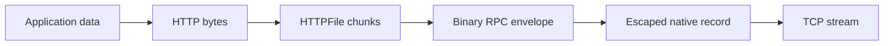

# 1C wire protocol

An unofficial, evidence-based specification of the observed 1C:Enterprise
client/server wire protocol, for developers building independent implementations
and protocol analyzers. This project is not affiliated with 1C.

**Status: initial draft, 2026-11-17.** The baseline is the native Windows x64
**8.3.18.1208** path. This describes a bounded subset, not the complete platform
protocol. Newer-build observations have separate evidence labels.

## Read the specification

| Chapter | Contents |
| --- | --- |
| [Scope and evidence](spec/00-scope.md) | Profiles, terminology, strength of claims and open boundaries |
| [Transport](spec/01-transport.md) | Greeting, record delimiters, escaping and stream parsing |
| [Serialization](spec/02-serialization.md) | Text lists, binary tags, structural flags and GUID byte order |
| [Bootstrap](spec/03-bootstrap.md) | Connection phases, introduction, interface query and context release |
| [HTTP RPC](spec/04-http-rpc.md) | Envelopes, HTTPFile, 16-KiB chunks, SecurityBlob and replies |
| [Session lifecycle](spec/05-session-lifecycle.md) | Authentication layers, identifiers, counters and cleanup |
| [Version matrix and gaps](spec/06-version-matrix.md) | Build-specific evidence and the next specification work |
| [Evidence register](evidence/README.md) | Claim-to-source mapping and exact input identities |
| [Synthetic vectors](vectors/README.md) | Machine-readable examples and offline checks |



HTTP publication through a web server is a separate transport profile. A native
worker port does not accept an ordinary HTTP request merely because both paths
use `/e1cib/` routes.

## Verify the examples

With Go 1.25 or later, from the repository root:

```sh
go test ./...
go vet ./...
```

The checks use only the standard library and synthetic data. They need no 1C
installation, credentials, companion repository or server. Passing them checks
the published examples; it does not establish interoperability with a server.

The first draft includes the corrected native HTTP-file continuation rule:
continuation chunks do **not** carry the ordinary-list `0x80` separator.

See [CONTRIBUTING](CONTRIBUTING.md) for the evidence required for a new claim and
[CHANGELOG](CHANGELOG.md) for corrections. The research archive and client
implementation are maintained separately; neither is copied into this project.
