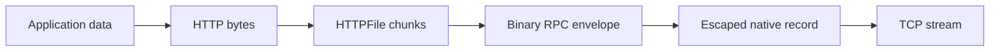

# 1C wire protocol

An unofficial, evidence-based specification of the observed 1C:Enterprise
client/server wire protocol, for developers building independent implementations
and protocol analyzers. This project is not affiliated with 1C.

**Status: expanded research draft, 2026-11-18.** The baseline is the native Windows x64
**8.3.18.1208** path. This describes a bounded subset, not the complete platform
protocol. Newer-build observations have separate evidence labels.

## Read the specification

| Chapter | Contents |
| --- | --- |
| [Scope and evidence](spec/00-scope.md) | Profiles, terminology, strength of claims and open boundaries |
| [Transport](spec/01-transport.md) | Greeting, record delimiters, escaping and stream parsing |
| [Serialization](spec/02-serialization.md) | Text lists, binary tags, structural flags and GUID byte order |
| [Bootstrap](spec/03-bootstrap.md) | Complete implemented manager/worker requests, replies, provider loop and release |
| [HTTP RPC](spec/04-http-rpc.md) | Envelopes, HTTPFile, 16-KiB chunks, SecurityBlob and replies |
| [Session lifecycle](spec/05-session-lifecycle.md) | Authentication layers, identifiers, counters and cleanup |
| [Version matrix and gaps](spec/06-version-matrix.md) | Exact-build evidence and unresolved compatibility |
| [Native authentication](spec/07-native-authentication.md) | Windows, legacy and SecPswd HTTP flows; inner security and session routing |
| [Security providers](spec/08-security-providers.md) | SSPI, explicit NTLMv2 and Kerberos integration |
| [SecPswd V1/V2/V3](spec/09-secpswd.md) | All messages, hashes, AES, CRC, flags and final proofs |
| [Build-27 policy](spec/10-native27-policy.md) | RSA header, n/c policy, 3DES framing and IV progression |
| [Web authentication](spec/11-web-authentication.md) | Served-contract selection, prelogin, settings, credential loop and logout |
| [Administration](spec/12-administration.md) | Contexts, marker, methods, authentication and worker enumeration |
| [Collection schemas](spec/13-collections.md) | Clusters, administrators, servers, processes, sessions and typed extensions |
| [Forms and values](spec/14-forms-and-values.md) | Ordered JSON, scalars, form calls, change tracking and collections |
| [Dynamic lists](spec/15-dynamic-lists.md) | Ordered window queries, descriptors, compact rows and bookmarks |
| [Files and storage](spec/16-files-and-storage.md) | Uploads, attachment, explicit confirmation and storage ownership |
| [Routes and errors](spec/17-routes-and-errors.md) | Additional known surfaces, native exceptions and reconciliation |
| [Independent client guide](spec/18-client-guide.md) | Implementation sequence and end-to-end state ownership |
| [Bootstrap/authentication audit](spec/19-bootstrap-auth-audit.md) | Corrected ambiguities, complete synthetic sessions and remaining implementation limits |
| [Evidence register](evidence/README.md) | Claim-to-source mapping and exact input identities |
| [Synthetic vectors](vectors/README.md) | Machine-readable examples and offline checks |



HTTP publication through a web server is a separate transport profile. A native
worker port does not accept an ordinary HTTP request merely because both paths
use `/e1cib/` routes.

## Verify the examples

With Go 1.25 or later, from the repository root:

```sh
go test ./...
go vet ./...
```

The checks use only the standard library and synthetic data. They need no 1C
installation, credentials, companion repository or server. Passing them checks
the published examples; it does not establish interoperability with a server.

Start with the [independent client guide](spec/18-client-guide.md). The examples
include complete synthetic V1/V2/V3 credential exchanges and a worker bootstrap
introduction, plus manager-to-logout and native/web HTTP orchestration traces.
The [implementation audit](spec/19-bootstrap-auth-audit.md) separates offline
verification from outstanding independent/live interoperability. These are
public conformance data, not copied debugging captures
or research test programs. Source provenance uses neutral identifiers and hashes.

See [CONTRIBUTING](CONTRIBUTING.md) for the evidence required for a new claim and
[CHANGELOG](CHANGELOG.md) for corrections. The research archive and client
implementation are maintained separately; neither is copied into this project.
